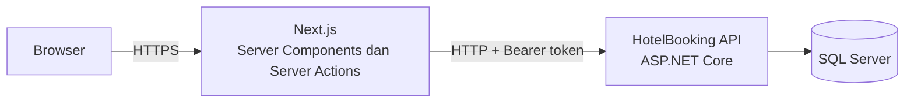
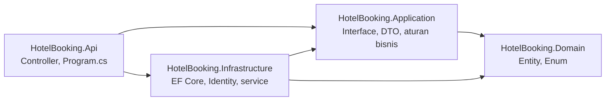
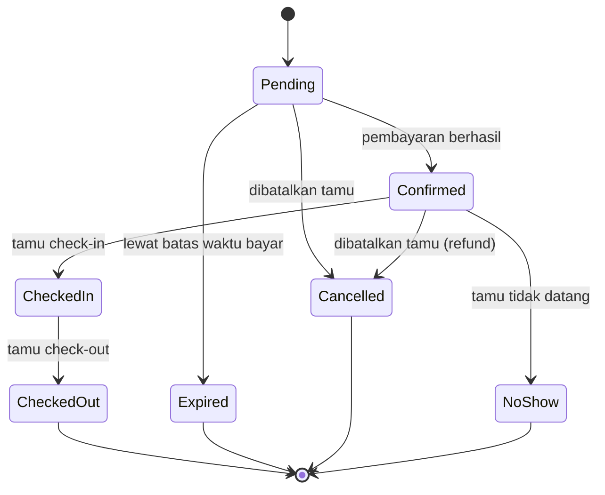

# Paradise View — Hotel Booking


Aplikasi pemesanan hotel lengkap: **backend ASP.NET Core Web API (.NET 10)** dengan arsitektur berlapis, **Entity Framework Core**, dan **SQL Server**, serta **frontend Next.js 16 (React 19, TypeScript, Tailwind CSS v4)**. Project portofolio untuk mendemonstrasikan desain backend .NET (pemodelan data, alur status booking, pencegahan double booking, aturan ketersediaan kamar) dan frontend modern yang terhubung ke API itu untuk tiga peran: tamu, resepsionis, dan admin.

Project ini terdiri dari tiga repository. **README ini sama di ketiganya.** Backend dan web dijalankan bersama lewat Docker Compose (bagian di bawah); aplikasi mobile berdiri sendiri dan memakai API yang sama.

| Repository | Isi | Folder lokal yang disarankan |
|---|---|---|
| [HotelBooking-Backend](https://github.com/hastabudiawan/HotelBooking-Backend) | API, database, tes, Docker backend | `HotelBooking-Backend` |
| [HotelBooking-Frontend](https://github.com/hastabudiawan/HotelBooking-Frontend) | Situs web Next.js, Docker frontend, compose gabungan | `HotelBooking-Frontend` |
| [HotelBooking-Mobile](https://github.com/hastabudiawan/HotelBooking-Mobile) | Aplikasi Flutter (iOS dan Android) | `HotelBooking-Mobile` |

> **Status:** backend, web, dan aplikasi mobile lengkap. Dari pencarian kamar sampai laporan okupansi sudah berjalan. Backend diuji dengan 61 tes otomatis (unit dan integrasi), frontend dengan 39 tes untuk logika inti, dan seluruh sistem bisa dijalankan dengan satu perintah Docker Compose di Windows, macOS, dan Linux. Aplikasi mobile **Flutter** untuk tamu (cari kamar, booking, bayar, riwayat) ada di repository ketiga dan punya 73 tes otomatis; cara menjalankannya ada di README repo itu.

<!-- Ganti dengan tangkapan layar nyata, simpan di docs/screenshots/ -->


## Coba dengan cepat

Cukup **Docker** dan **Git**. Tidak perlu memasang .NET, Node, atau SQL Server. Letakkan kedua repo **berdampingan** dalam satu folder.

**macOS dan Linux (terminal), atau Git Bash di Windows:**

```bash
mkdir HotelBooking && cd HotelBooking
git clone https://github.com/hastabudiawan/HotelBooking-Backend.git
git clone https://github.com/hastabudiawan/HotelBooking-Frontend.git

cd HotelBooking-Backend
cp .env.example .env            # lalu isi nilainya, lihat bagian "Menjalankan Project"
cd ../HotelBooking-Frontend

docker compose -f docker-compose.full.yml --env-file ../HotelBooking-Backend/.env up --build
```

**Windows (PowerShell):**

```powershell
mkdir HotelBooking; cd HotelBooking
git clone https://github.com/hastabudiawan/HotelBooking-Backend.git
git clone https://github.com/hastabudiawan/HotelBooking-Frontend.git

cd HotelBooking-Backend
Copy-Item .env.example .env     # lalu isi nilainya, lihat bagian "Menjalankan Project"
cd ..\HotelBooking-Frontend

docker compose -f docker-compose.full.yml --env-file ../HotelBooking-Backend/.env up --build
```

Buka `http://localhost:3000`. Masuk sebagai admin dengan `ADMIN_EMAIL` dan `ADMIN_PASSWORD` dari file `.env`. Database dimulai kosong, dan akun admin dibuat otomatis. Pengaturan lengkap per sistem operasi ada di bagian [Memasang Alat](#memasang-alat).

---

## Daftar Isi

- [Fitur](#fitur)
- [Teknologi](#teknologi)
- [Arsitektur](#arsitektur)
- [Struktur Folder](#struktur-folder)
- [Alur dan Aturan Bisnis](#alur-dan-aturan-bisnis)
- [Keputusan Teknis Frontend](#keputusan-teknis-frontend)
- [Halaman Web](#halaman-web)
- [Memasang Alat](#memasang-alat)
- [Mengambil Kode](#mengambil-kode)
- [Menjalankan Project](#menjalankan-project)
- [Setup SQL Server](#setup-sql-server)
- [Nyalakan dan Matikan Sehari-hari](#nyalakan-dan-matikan-sehari-hari)
- [Pengujian dan CI](#pengujian-dan-ci)
- [Endpoint API](#endpoint-api)
- [Variabel Lingkungan](#variabel-lingkungan)
- [Menayangkan di Server](#menayangkan-di-server)
- [Reset dan Bersih-bersih](#reset-dan-bersih-bersih)
- [Masalah Umum](#masalah-umum)
- [Keterbatasan yang Diketahui](#keterbatasan-yang-diketahui)
- [Catatan Keamanan](#catatan-keamanan)
- [Roadmap](#roadmap)
- [Penulis](#penulis)

---

## Fitur

### Backend

- [x] Solution berlapis (Domain, Application, Infrastructure, Api) dan project test
- [x] Model data: tipe kamar, kamar, booking, pembayaran, dan pengguna (ASP.NET Core Identity)
- [x] Migration EF Core dan data awal (3 tipe kamar, 5 kamar)
- [x] Autentikasi JWT dan tiga role (Guest, Receptionist, Admin), dengan seeding akun admin
- [x] Pengelolaan tipe kamar (admin) dan kamar (admin dan resepsionis), dengan slug ramah SEO
- [x] Pencarian ketersediaan kamar berdasarkan tanggal dan jumlah tamu
- [x] Booking tanpa double booking, bahkan saat banyak permintaan masuk bersamaan
- [x] Pembayaran simulasi, hold 15 menit, dan expired otomatis lewat background service
- [x] Pembatalan dengan refund otomatis untuk booking yang sudah dibayar
- [x] Check-in, check-out, dan penandaan no-show oleh resepsionis
- [x] Laporan okupansi dan pendapatan per hari (admin)
- [x] Dokumentasi API interaktif (OpenAPI dan Scalar), CORS untuk frontend Next.js, dan health check
- [x] 40 unit test dan 21 tes integrasi (SQL Server asli lewat Testcontainers)
- [x] Docker Compose dan CI dengan GitHub Actions
- [x] Koleksi Postman dengan pengecekan otomatis

### Frontend: tamu

- [x] Beranda, daftar kamar, detail kamar, serta halaman Explore, About, dan Contact
- [x] Pencarian ketersediaan berdasarkan tanggal dan jumlah tamu
- [x] Daftar dan login (JWT di cookie httpOnly)
- [x] Booking dengan batas bayar 15 menit dan hitung mundur
- [x] Pembayaran simulasi (Transfer, QRIS, Kartu, dengan opsi simulasi gagal)
- [x] Pembatalan booking dan riwayat booking dengan filter status
- [x] SEO: metadata per halaman, Open Graph, `sitemap.xml`, dan `robots.txt`

### Frontend: resepsionis

- [x] Ringkasan harian dan pencarian booking
- [x] Check-in, check-out, dan penandaan no-show
- [x] Pengelolaan status kamar (Available, Cleaning, Maintenance)

### Frontend: admin

- [x] Kelola tipe kamar (tambah, ubah, hapus, URL gambar)
- [x] Kelola kamar fisik
- [x] Buat akun resepsionis
- [x] Laporan okupansi dan pendapatan per hari dengan grafik dan tabel

### Rekayasa frontend

- [x] Pembagian peran di tampilan dan di setiap Server Action
- [x] Cache bertanda untuk data tipe kamar
- [x] Tes otomatis untuk logika murni (Vitest)
- [x] Docker multi-tahap, Docker Compose gabungan, dan CI GitHub Actions

---

## Teknologi

| Bagian | Teknologi |
|---|---|
| Bahasa dan framework backend | C#, ASP.NET Core Web API (.NET 10) |
| ORM | Entity Framework Core (code-first, migrations) |
| Database | Microsoft SQL Server 2022 |
| Identitas dan keamanan | ASP.NET Core Identity, JWT Bearer |
| Dokumentasi API | OpenAPI dan Scalar |
| Framework frontend | Next.js 16 (App Router), React 19, TypeScript |
| Tampilan | Tailwind CSS v4, `next/font`, `lucide-react` |
| Pengujian | xUnit, `WebApplicationFactory`, Testcontainers (backend); Vitest (frontend) |
| Infrastruktur | Docker, Docker Compose, GitHub Actions |
| Uji manual | Postman |

---

## Arsitektur

### Sistem



Browser hanya berbicara dengan server Next.js. Semua panggilan ke API terjadi di server, sehingga token tidak pernah terjangkau JavaScript di browser dan frontend ini tidak membutuhkan pengaturan CORS.

### Layer backend

Solution dipisah menjadi empat layer. Logika bisnis tidak bergantung pada database maupun HTTP, sehingga mudah diuji dan dikembangkan.



| Layer | Tanggung jawab |
|---|---|
| `Domain` | Entity dan enum. Tidak bergantung pada layer atau framework lain |
| `Application` | Kontrak (interface), DTO, dan aturan bisnis murni (fungsi tanpa efek samping, mudah diuji) |
| `Infrastructure` | `AppDbContext`, EF Core, migration, implementasi service, dan background service |
| `Api` | Controller, konfigurasi aplikasi, dan dokumentasi API |

---

## Struktur Folder

### Backend (`HotelBooking-Backend`)

```
HotelBooking-Backend/
├── .github/workflows/ci.yml        # CI: build, unit test, tes integrasi, smoke test Docker
├── docs/postman/                   # Koleksi Postman
├── src/
│   ├── HotelBooking.Domain/        # Entity dan enum
│   ├── HotelBooking.Application/   # Interface, DTO, aturan bisnis
│   ├── HotelBooking.Infrastructure/# DbContext, migration, Identity, service
│   └── HotelBooking.Api/           # Controller dan Program.cs
├── tests/
│   └── HotelBooking.Tests/         # Unit test dan tes integrasi (xUnit)
├── Dockerfile
├── docker-compose.yml              # Database + API (backend saja)
├── .env.example                    # Contoh konfigurasi untuk Docker Compose
└── HotelBooking.slnx
```

### Frontend (`HotelBooking-Frontend`)

```
HotelBooking-Frontend/
├── .github/workflows/ci.yml        # CI: lint, tes, build, uji image Docker
├── public/images/                  # Foto kamar dan aset
├── src/
│   ├── app/                        # Halaman (App Router) dan rute /api/health
│   │   ├── rooms/ booking/ account/ staff/ admin/ login/ register/ ...
│   │   └── sitemap.ts, robots.ts
│   ├── components/                 # Komponen UI, layout, kamar, booking, staff, admin
│   ├── lib/
│   │   ├── api/                    # Klien API dan fungsi per bagian
│   │   ├── auth/                   # Sesi, JWT, pengaman peran, aksi login dan daftar
│   │   ├── admin/, bookings/, staff/  # Server Actions
│   │   └── *.ts                    # Format, status booking, rentang laporan, URL gambar
│   └── proxy.ts                    # Pengalihan awal untuk halaman yang butuh login
├── Dockerfile
├── docker-compose.full.yml         # Database + API + frontend (seluruh sistem)
├── vitest.config.mts
└── .env.example
```

---

## Alur dan Aturan Bisnis

### Status booking



### Ketersediaan kamar

Sebuah kamar tersedia untuk rentang `[checkIn, checkOut)` jika tidak ada booking aktif pada kamar itu yang tanggalnya bertabrakan. Booking aktif adalah `Confirmed`, `CheckedIn`, atau `Pending` yang belum lewat `ExpiresAt`. Dua rentang tanggal bertabrakan jika:

```
checkIn_baru < checkOut_lama  DAN  checkOut_baru > checkIn_lama
```

Tanggal check-out tidak dihitung sebagai malam menginap, sehingga tamu baru boleh check-in pada hari tamu lama check-out. Kamar berstatus `Maintenance` tidak ditawarkan. Aturan tanggal mengikuti jam hotel (WIB, UTC+7), dengan maksimal 30 malam per booking.

### Pencegahan double booking

- Saat booking dibuat, pengecekan ketersediaan diulang **di dalam transaksi** yang mengunci baris kamar (`UPDLOCK, ROWLOCK`). Permintaan paralel untuk kamar yang sama diproses bergantian.
- Kunci yang sama dipakai saat pembayaran dan saat check-in atau check-out, sehingga perubahan status tidak bisa saling menimpa.
- `Booking` memiliki `RowVersion` (concurrency token) untuk pembatalan, pembayaran, dan perubahan status oleh staf.
- Hal ini dibuktikan oleh tes integrasi: puluhan booking paralel untuk satu kamar hanya menghasilkan satu yang berhasil.

### Pembayaran dan kedaluwarsa

- Booking baru berstatus `Pending` dan menahan kamar selama 15 menit.
- Pembayaran adalah simulasi. Pembayaran yang gagal mengembalikan `200` dengan `payment.status = Failed`, dan booking tetap `Pending` sehingga tamu bisa mencoba lagi.
- `BookingExpiryService` (background service) mengubah booking `Pending` yang lewat batas waktu menjadi `Expired`, sehingga kamarnya bebas kembali.
- Membatalkan booking `Confirmed` otomatis mengubah pembayarannya menjadi `Refunded`.
- Total harga disimpan pada booking saat dibuat, sehingga perubahan tarif tidak mengubah booking lama.

### Front desk

- Check-in membutuhkan booking `Confirmed`, hari ini berada dalam masa menginap, dan kamar berstatus `Available`. Kamar lalu menjadi `Occupied`.
- Check-out mengubah kamar menjadi `Cleaning`. Resepsionis mengembalikannya ke `Available` setelah dibersihkan.
- No-show hanya boleh dicatat setelah tanggal check-in, dan tidak ada refund.
- Laporan okupansi menghitung room-night terjual dan pendapatan per hari, dengan rentang maksimal 92 hari (batas awal dan akhir sama-sama termasuk).

---

## Keputusan Teknis Frontend

- **Semua panggilan API di sisi server.** Token JWT tersimpan di cookie `pv_session` (httpOnly, SameSite=Lax, dan Secure di produksi) yang diatur oleh Server Action. Kode di browser tidak bisa membaca token.
- **Backend adalah penentu keamanan.** Frontend membaca isi token hanya untuk menampilkan nama dan memilih menu, serta memeriksa peran di layout dan di setiap halaman. Setiap endpoint tetap dijaga atribut peran di backend, jadi mengakali tampilan tidak membuka data.
- **Peran dicek di dua tempat.** Halaman staf dan admin memanggil pengaman peran di layout dan di setiap halaman. Fungsi Server Action dicek lagi, karena fungsi di berkas `"use server"` bisa dipanggil langsung dari luar.
- **Pengalihan aman.** Parameter `next` setelah login divalidasi (`safeNext`) untuk mencegah open redirect, dan ada pengaman agar tidak terjadi putaran login saat token ditolak backend.
- **Cache bertanda.** Daftar tipe kamar di-cache untuk kecepatan, tetapi dibuang seketika setelah admin mengubah data, jadi halaman publik langsung segar.
- **Logika murni dipisah dan diuji.** Aturan tanggal, pembaca token, status booking, pengalihan, validasi URL gambar, dan rentang laporan ada di fungsi murni yang mudah diuji.
- **Zona waktu hotel (WIB).** Tanggal dibaca sebagai tanggal kalender tanpa pergeseran zona waktu, dan waktu server (UTC) ditampilkan sebagai WIB.
- **Batas bayar tampil jujur.** Booking `Pending` yang lewat batas waktu langsung ditampilkan sebagai kedaluwarsa, walaupun job latar belakang backend baru mengubah statusnya beberapa saat kemudian.

---

## Halaman Web

| Alamat | Isi | Akses |
|---|---|---|
| `/` | Beranda dan kotak pencarian | Publik |
| `/rooms`, `/rooms/[slug]` | Daftar dan detail kamar, cek ketersediaan | Publik |
| `/explore`, `/about`, `/contact` | Halaman informasi | Publik |
| `/login`, `/register` | Masuk dan daftar | Publik |
| `/booking/new` | Membuat booking | Tamu |
| `/account`, `/account/bookings`, `/account/bookings/[id]` | Akun, riwayat, detail dan pembayaran | Tamu |
| `/staff`, `/staff/bookings`, `/staff/rooms` | Panel resepsionis | Resepsionis, Admin |
| `/admin`, `/admin/room-types`, `/admin/rooms`, `/admin/staff`, `/admin/reports` | Panel admin dan laporan | Admin |
| `/api/health` | Health check untuk Docker | Publik |

Halaman yang tidak boleh diakses oleh peran tertentu menampilkan 404.

---

## Memasang Alat

Alat apa yang dibutuhkan tergantung cara menjalankan:

| Alat | Cara 1 dan 2 (Docker saja) | Cara 3 (pengembangan) | Catatan |
|---|---|---|---|
| Git | Ya | Ya | Mengambil kode |
| Docker | Ya | Ya (untuk database) | Docker Desktop (Windows, macOS) atau Docker Engine (Linux) |
| [.NET 10 SDK](https://dotnet.microsoft.com/download) | Tidak | Ya | Cek: `dotnet --version` |
| `dotnet-ef` | Tidak | Ya | `dotnet tool install --global dotnet-ef` |
| [Node.js](https://nodejs.org/) (LTS terbaru) | Tidak | Ya | Cek: `node -v` dan `npm -v` |
| [Postman Desktop](https://www.postman.com/downloads/) | Opsional | Opsional | Versi web tidak bisa memanggil `localhost` |

Sumber unduhan dan langkah resmi bisa berubah, jadi bagian di bawah merangkum garis besarnya. Kalau ada langkah yang berbeda, ikuti dokumentasi resmi tiap alat.

### Windows 10 dan 11

1. **Git:** pasang [Git for Windows](https://git-scm.com/download/win). Ini juga memberi **Git Bash**, terminal yang menjalankan perintah bergaya macOS dan Linux di README ini.
2. **Docker Desktop:** pasang [Docker Desktop](https://www.docker.com/products/docker-desktop/) dan pilih **WSL 2** sebagai backend (bawaan di Windows terbaru). Buka aplikasinya, tunggu sampai berstatus *Engine running*, dan pastikan mode **Linux containers** (bawaan). Image SQL Server adalah image Linux.
3. **.NET SDK dan Node.js (hanya Cara 3):** pasang dari situs resminya, atau lewat `winget`:

   ```powershell
   winget install Microsoft.DotNet.SDK.10
   winget install OpenJS.NodeJS.LTS
   ```

4. **Terminal:** gunakan **PowerShell** (blok berlabel *Windows*) atau **Git Bash** (blok *macOS dan Linux*). Jangan memakai Command Prompt (`cmd`) lama.
5. Beberapa perbedaan penting di PowerShell:
   - `curl` adalah alias `Invoke-WebRequest`. Pakai **`curl.exe`**, atau `Invoke-RestMethod`.
   - Perintah panjang disambung dengan tanda kutip terbalik (`` ` ``), bukan `\`. Di README ini perintah Windows ditulis dalam satu baris agar aman.
   - Mengganti `cp` dengan `Copy-Item`, dan `export` dengan `$env:NAMA = "nilai"`.

Tips: kalau memakai WSL (Ubuntu di dalam Windows), ikuti petunjuk **Linux** di dalam WSL dan simpan kode di dalam filesystem Linux (misalnya `~/HotelBooking`), bukan di `/mnt/c/...`, supaya jauh lebih cepat.

### macOS

1. **Git dan Node.js:** dengan [Homebrew](https://brew.sh/):

   ```bash
   brew install git node
   ```

2. **Docker Desktop:**

   ```bash
   brew install --cask docker
   ```

   Buka aplikasinya, tunggu sampai *Engine running*. Di **Apple Silicon** (M1 dan seterusnya), aktifkan **Use Rosetta for x86_64/amd64 emulation** di *Settings > General*, karena SQL Server berjalan sebagai amd64 lewat emulasi. Start-nya lambat (sekitar satu menit), dan itu normal.
3. **.NET SDK (hanya Cara 3):** unduh dari [dotnet.microsoft.com/download](https://dotnet.microsoft.com/download), atau `brew install --cask dotnet-sdk`.
4. Terminal bawaan (zsh) cukup.

### Linux (Ubuntu, Debian, Fedora, dan sejenisnya)

1. **Git dan Node.js:** lewat manajer paket distribusimu, misalnya di Ubuntu:

   ```bash
   sudo apt update
   sudo apt install -y git curl
   ```

   Untuk Node.js LTS terbaru, ikuti [petunjuk resmi](https://nodejs.org/en/download) (misalnya lewat `nvm`), karena versi di repositori distribusi sering lawas.
2. **Docker Engine dan plugin Compose:** ikuti [dokumentasi instalasi Docker untuk distribusimu](https://docs.docker.com/engine/install/), lalu izinkan user biasa memakai Docker:

   ```bash
   sudo usermod -aG docker $USER
   ```

   Keluar dan masuk lagi (atau reboot), lalu cek `docker run hello-world` dan `docker compose version`.
3. **.NET SDK (hanya Cara 3):** ikuti [petunjuk resmi](https://learn.microsoft.com/dotnet/core/install/linux) untuk distribusimu.
4. **Catatan arsitektur:** image SQL Server hanya tersedia untuk **amd64 (x86_64)**. Di Linux ARM (misalnya Raspberry Pi), database tidak jalan secara bawaan. Emulasi lewat QEMU kadang bisa tetapi lambat dan tidak dijamin, dan belum diuji di project ini. Alternatifnya, jalankan database di mesin x86_64 atau layanan cloud.
5. **Memori:** container SQL Server butuh minimal sekitar **2 GB RAM** untuk dirinya sendiri. Sediakan lebih supaya sistem tetap lancar.

---

## Mengambil Kode

Letakkan kedua repo **berdampingan** dalam satu folder. Compose gabungan di repo frontend membangun backend dari folder di sebelahnya, jadi nama dan letak folder penting:

```
HotelBooking/
├── HotelBooking-Backend/
└── HotelBooking-Frontend/
```

```bash
mkdir HotelBooking && cd HotelBooking
git clone https://github.com/hastabudiawan/HotelBooking-Backend.git
git clone https://github.com/hastabudiawan/HotelBooking-Frontend.git
```

(Di PowerShell: `mkdir HotelBooking; cd HotelBooking`, lalu dua perintah `git clone` yang sama.)

Hal yang **tidak ikut** ke Git dan harus dibuat ulang di perangkat baru:

| Hal | Alasannya | Dibuat di |
|---|---|---|
| File `.env` (backend) | Berisi password | Cara 1, langkah 1 |
| User-secrets | Tersimpan di komputer, di luar repo | Cara 3, langkah 2 |
| File `.env.local` (frontend) | Alamat API lokal | Cara 3, langkah 5 |
| Data database | Tersimpan di volume Docker, bukan di Git | Terbuat otomatis, mulai dari kosong. Akun admin dibuat oleh seeder |

---

## Menjalankan Project

Ada tiga cara. Pilih sesuai kebutuhan:

| | Cara 1: Compose gabungan | Cara 2: Compose backend saja | Cara 3: Pengembangan |
|---|---|---|---|
| Cocok untuk | Mencoba seluruh sistem, demo, perangkat baru | Hanya butuh API (Postman, Scalar, frontend dev) | Mengembangkan dan men-debug kode |
| Yang dibutuhkan | Docker | Docker | .NET SDK, Node.js, Docker (untuk database) |
| Frontend | `http://localhost:3000` (di Docker) | `npm run dev` (opsional) | `npm run dev` |
| Alamat API | `http://localhost:8080` | `http://localhost:8080` | `http://localhost:5047` |
| Database | Container `db` milik compose (volume `sqldata`) | Container `db` milik compose backend, port host 1434 | Container `hotel-sqlserver`, port host 1433 |
| Konfigurasi | `.env` backend | `.env` backend | `dotnet user-secrets` dan `.env.local` |
| Migrasi database | Otomatis saat API start | Otomatis saat API start | Manual: `dotnet ef database update` |

Ketiganya memakai database yang **terpisah**, jadi password dan datanya tidak saling terkait. Cara 1 dan Cara 2 memakai port API yang sama (8080), jadi jangan menyalakan keduanya bersamaan.

### Membuat file `.env` (untuk Cara 1 dan 2)

Dari folder `HotelBooking-Backend`. Isi `.env`:

```
SA_PASSWORD=<password-sql-server>
JWT_KEY=<kunci-acak-minimal-32-karakter>
ADMIN_EMAIL=admin@hotel.local
ADMIN_PASSWORD=<password-admin>
FRONTEND_ORIGIN=http://localhost:3000
```

**macOS, Linux, Git Bash:** perintah ini membuat file sekaligus kunci JWT acak:

```bash
cat > .env <<EOF
SA_PASSWORD=<password-sql-server>
JWT_KEY=$(openssl rand -base64 36)
ADMIN_EMAIL=admin@hotel.local
ADMIN_PASSWORD=<password-admin>
FRONTEND_ORIGIN=http://localhost:3000
EOF
```

**Windows (PowerShell):** salin contohnya, lalu edit di VS Code atau Notepad:

```powershell
Copy-Item .env.example .env
notepad .env
```

Untuk `JWT_KEY` di Windows, buat kunci acak dengan perintah ini, lalu tempel hasilnya ke `.env`:

```powershell
$bytes = New-Object byte[] 36; [System.Security.Cryptography.RandomNumberGenerator]::Create().GetBytes($bytes); [Convert]::ToBase64String($bytes)
```

Simpan `.env` sebagai teks biasa (UTF-8), tanpa tanda kutip di sekitar nilai.

| Variable | Aturan |
|---|---|
| `SA_PASSWORD` | Minimal 8 karakter, ada huruf besar, huruf kecil, dan angka. **Jangan memakai `;` atau `$`** |
| `JWT_KEY` | Minimal 32 karakter. Hasil `openssl rand -base64 36` sudah memenuhi |
| `ADMIN_EMAIL` | Email akun admin awal |
| `ADMIN_PASSWORD` | Minimal 8 karakter, ada huruf besar, huruf kecil, dan angka |
| `FRONTEND_ORIGIN` | Alamat frontend yang boleh memanggil API (CORS) |

Pastikan `.env` tidak masuk Git: `git check-ignore .env` harus mencetak `.env`.

### Cara 1: Docker Compose gabungan (seluruh sistem)

**1. Buat `.env`** seperti di atas.

**2. Nyalakan.** Dari folder `HotelBooking-Frontend` (perintahnya sama di semua sistem operasi):

```bash
docker compose -f docker-compose.full.yml --env-file ../HotelBooking-Backend/.env up --build
```

Opsi `--env-file` wajib ada di setiap perintah `docker compose` untuk file ini. Tambahkan `-d` untuk berjalan di latar belakang. Build pertama memakan beberapa menit, dan SQL Server butuh sekitar satu menit untuk siap (lebih lama di Apple Silicon).

**3. Cek:**

macOS, Linux, Git Bash:

```bash
curl -i http://localhost:3000/api/health      # harus 200 {"status":"ok"}
curl -i http://localhost:8080/health          # harus 200, health check backend
```

Windows (PowerShell):

```powershell
curl.exe -i http://localhost:3000/api/health
curl.exe -i http://localhost:8080/health
```

Lalu buka `http://localhost:3000` dan masuk sebagai admin.

**4. Matikan:**

```bash
docker compose -f docker-compose.full.yml --env-file ../HotelBooking-Backend/.env stop        # matikan, data tetap ada
docker compose -f docker-compose.full.yml --env-file ../HotelBooking-Backend/.env down        # hapus container, data tetap ada
docker compose -f docker-compose.full.yml --env-file ../HotelBooking-Backend/.env down -v     # hapus container DAN data database
```

Compose gabungan mengatur `COOKIE_SECURE=false` supaya login berfungsi lewat `http://localhost` (Safari menolak cookie `Secure` di HTTP). Di server dengan HTTPS, isi `COOKIE_SECURE=true`.

### Cara 2: Docker Compose backend saja

**1. Buat `.env`** seperti di atas.

**2. Nyalakan.** Dari folder `HotelBooking-Backend`:

```bash
docker compose up --build        # terminal terkunci, log terlihat
docker compose up -d             # di latar belakang
```

Build pertama memakan beberapa menit. SQL Server butuh sekitar satu menit untuk siap. Tanda berhasil di log: `db ... Healthy`, `Applying migration '...InitialCreate'`, dan `Now listening on: http://[::]:8080`.

**3. Cek:**

macOS, Linux, Git Bash:

```bash
curl -i http://localhost:8080/health      # harus 200 Healthy
curl -s -X POST http://localhost:8080/api/auth/login \
  -H "Content-Type: application/json" \
  -d '{"email":"admin@hotel.local","password":"<password-admin>"}'
```

Windows (PowerShell):

```powershell
curl.exe -i http://localhost:8080/health
Invoke-RestMethod -Method Post -Uri http://localhost:8080/api/auth/login -ContentType "application/json" -Body '{"email":"admin@hotel.local","password":"<password-admin>"}'
```

Dokumentasi Scalar tidak aktif di mode Production (sengaja). Pakai Postman, atau jalankan Cara 3 untuk melihat Scalar.

**4. Matikan:**

```bash
docker compose stop        # matikan, data tetap ada
docker compose down        # hapus container, data tetap ada (di volume)
docker compose down -v     # hapus container DAN data database
```

**5. (Opsional) Frontend dalam mode pengembangan.** Dengan API berjalan di `:8080`, lihat Cara 3, langkah 5 dan 6, dan isi `API_URL=http://localhost:8080`.

### Cara 3: pengembangan dengan `dotnet run` dan `npm run dev`

**1. Database SQL Server** (sekali saja per perangkat). Ganti `<password-sql-server>` dengan password pilihanmu (minimal 8 karakter, ada huruf besar, kecil, angka, dan simbol). Penjelasan lengkap ada di bagian [Setup SQL Server](#setup-sql-server).

macOS (Intel), Linux x86_64, Git Bash, dan Windows (PowerShell), cukup satu baris:

```bash
docker run -e "ACCEPT_EULA=Y" -e "MSSQL_SA_PASSWORD=<password-sql-server>" -p 1433:1433 --name hotel-sqlserver -d mcr.microsoft.com/mssql/server:2022-latest
```

macOS **Apple Silicon**, tambahkan `--platform linux/amd64`:

```bash
docker run --platform linux/amd64 -e "ACCEPT_EULA=Y" -e "MSSQL_SA_PASSWORD=<password-sql-server>" -p 1433:1433 --name hotel-sqlserver -d mcr.microsoft.com/mssql/server:2022-latest
```

**2. User-secrets backend** (sekali saja per perangkat). Konfigurasi sensitif tidak disimpan di repository. Dari folder `HotelBooking-Backend`:

macOS, Linux, Git Bash:

```bash
dotnet user-secrets init --project src/HotelBooking.Api

dotnet user-secrets set "ConnectionStrings:DefaultConnection" "Server=localhost,1433;Database=HotelBookingDb;User Id=sa;Password=<password-sql-server>;TrustServerCertificate=True" --project src/HotelBooking.Api
dotnet user-secrets set "Jwt:Key" "$(openssl rand -base64 48)" --project src/HotelBooking.Api
dotnet user-secrets set "SeedAdmin:Email" "admin@hotel.local" --project src/HotelBooking.Api
dotnet user-secrets set "SeedAdmin:Password" "<password-admin>" --project src/HotelBooking.Api
```

Windows (PowerShell):

```powershell
dotnet user-secrets init --project src/HotelBooking.Api

$bytes = New-Object byte[] 48; [System.Security.Cryptography.RandomNumberGenerator]::Create().GetBytes($bytes); $key = [Convert]::ToBase64String($bytes)

dotnet user-secrets set "ConnectionStrings:DefaultConnection" "Server=localhost,1433;Database=HotelBookingDb;User Id=sa;Password=<password-sql-server>;TrustServerCertificate=True" --project src/HotelBooking.Api
dotnet user-secrets set "Jwt:Key" $key --project src/HotelBooking.Api
dotnet user-secrets set "SeedAdmin:Email" "admin@hotel.local" --project src/HotelBooking.Api
dotnet user-secrets set "SeedAdmin:Password" "<password-admin>" --project src/HotelBooking.Api
```

Gunakan tanda kutip lurus (`"`), bukan kutip melengkung. Cek isinya dengan `dotnet user-secrets list --project src/HotelBooking.Api` (harus ada empat baris). Alamat frontend untuk CORS sudah ada di `appsettings.Development.json`.

**3. Buat database dan tabel** (sekali saja, dan setiap ada migration baru):

macOS, Linux, Git Bash:

```bash
dotnet ef database update \
  --project src/HotelBooking.Infrastructure \
  --startup-project src/HotelBooking.Api
```

Windows (PowerShell, satu baris):

```powershell
dotnet ef database update --project src/HotelBooking.Infrastructure --startup-project src/HotelBooking.Api
```

**4. Jalankan backend:**

```bash
dotnet run --project src/HotelBooking.Api
```

| Alamat | Isi |
|---|---|
| `http://localhost:5047/health` | Health check |
| `http://localhost:5047/scalar` | Dokumentasi API interaktif (kalau tidak terbuka, coba `/scalar/v1`) |

Hentikan dengan **Ctrl+C**. Seeder hanya membuat akun admin kalau belum ada, jadi mengubah `SeedAdmin:Password` setelah admin terbuat tidak mengubah password admin yang sudah ada di database.

**5. Siapkan frontend** (sekali saja). Dari folder `HotelBooking-Frontend`:

macOS, Linux, Git Bash:

```bash
cp .env.example .env.local
npm install
```

Windows (PowerShell):

```powershell
Copy-Item .env.example .env.local
npm install
```

Buka `.env.local` dan sesuaikan `API_URL`:

```
API_URL=http://localhost:5047
SITE_URL=http://localhost:3000
```

(Pakai `http://localhost:8080` kalau API-nya berjalan lewat Docker Compose.) Kalau muncul `ECONNREFUSED`, coba `http://127.0.0.1:5047`, karena `localhost` kadang diterjemahkan ke IPv6.

**6. Jalankan frontend:**

```bash
npm run dev
```

Buka `http://localhost:3000`.

---

## Setup SQL Server

Backend memakai **Microsoft SQL Server 2022**. Cara paling seragam di semua sistem operasi adalah menjalankannya dalam **container Docker**, jadi tidak perlu memasang SQL Server ke komputer.

### Lewat Docker (disarankan, semua sistem operasi)

- **Cara 1 dan 2:** database sudah termasuk di file compose (service `db`) dan dikonfigurasi otomatis dari `SA_PASSWORD` di `.env`. Tidak ada yang perlu disiapkan manual. Data tersimpan di volume Docker `sqldata`.
- **Cara 3:** database dijalankan manual sebagai container `hotel-sqlserver` (perintah di Cara 3, langkah 1). Backend terhubung lewat connection string di user-secrets.

Hal yang perlu diketahui:

| Hal | Penjelasan |
|---|---|
| Image | `mcr.microsoft.com/mssql/server:2022-latest`, hanya untuk amd64 |
| Login | User `sa` dengan password dari `SA_PASSWORD` (compose) atau `MSSQL_SA_PASSWORD` (`docker run`) |
| Aturan password | Minimal 8 karakter, campuran huruf besar, huruf kecil, angka. **Jangan memakai `;` atau `$`** karena merusak connection string dan sintaks compose |
| Memori | Butuh sekitar 2 GB RAM atau lebih untuk container ini |
| Waktu start | Sekitar satu menit di Apple Silicon (emulasi), lebih cepat di x86_64 |
| Persistensi | Data aman selama volume tidak dihapus. `docker compose down -v` menghapusnya |

Port di komputermu:

| Cara | Port host | Connection string dari komputermu |
|---|---|---|
| Cara 1 (compose gabungan) | Tidak dibuka (hanya jaringan internal Docker) | Tambahkan `ports: ["127.0.0.1:1434:1433"]` pada service `db` kalau ingin mengintip |
| Cara 2 (compose backend) | 1434 | `Server=localhost,1434;...` |
| Cara 3 (`hotel-sqlserver`) | 1433 | `Server=localhost,1433;...` |

Di dalam jaringan Docker, API terhubung ke `Server=db,1433`, bukan `localhost`.

### Melihat isi database

Gunakan salah satu alat yang berjalan di Windows, macOS, dan Linux:

- **Azure Data Studio** atau **DBeaver**, dengan server `localhost,1434` (Cara 2) atau `localhost,1433` (Cara 3), login SQL Server (`sa`), dan opsi **Trust server certificate** aktif. Nama database: `HotelBookingDb`.
- **`sqlcmd`** dari dalam container, tanpa memasang apa pun di komputer:

  ```bash
  docker exec -it hotel-sqlserver /opt/mssql-tools18/bin/sqlcmd -C -S localhost -U sa -P "<password-sql-server>" -Q "SELECT name FROM sys.databases"
  ```

  Untuk compose, ganti `hotel-sqlserver` dengan nama container `db` (lihat `docker ps`).

### Alternatif tanpa Docker (Windows, belum diuji di project ini)

Di Windows kamu bisa memasang **SQL Server Express** atau **LocalDB** secara langsung, lalu mengganti connection string di user-secrets. Contohnya untuk Express dengan login Windows:

```
Server=localhost\SQLEXPRESS;Database=HotelBookingDb;Trusted_Connection=True;TrustServerCertificate=True
```

Hanya Cara 3 yang cocok dengan pilihan ini. Cara 1 dan 2 tetap memakai container.

---

## Nyalakan dan Matikan Sehari-hari

Setelah komputer dimatikan, container tidak otomatis menyala lagi. **Data tidak hilang**, karena tersimpan di volume Docker. Mulai dengan membuka Docker Desktop (atau memastikan layanan Docker Engine berjalan di Linux), dan tunggu sampai statusnya "Running".

| | Cara 1 (compose gabungan) | Cara 2 (compose backend) | Cara 3 (pengembangan) |
|---|---|---|---|
| Nyalakan | `docker compose -f docker-compose.full.yml --env-file ../HotelBooking-Backend/.env up -d` (dari folder frontend), tunggu sekitar 1 menit, cek `/api/health` | `docker compose up -d` (dari folder backend), tunggu sekitar 1 menit, cek `/health` | `docker start hotel-sqlserver`, tunggu beberapa detik, lalu `dotnet run --project src/HotelBooking.Api` dan `npm run dev` |
| Matikan | `... stop` | `docker compose stop` | Ctrl+C untuk API dan frontend, lalu `docker stop hotel-sqlserver` |

| Tujuan | Perintah |
|---|---|
| Lihat container yang menyala | `docker ps` |
| Lihat semua container (termasuk mati) | `docker ps -a` |
| Log frontend (compose gabungan) | `docker compose -f docker-compose.full.yml --env-file ../HotelBooking-Backend/.env logs -f web` |
| Log API (compose backend) | `docker compose logs -f api` |
| Log database (compose backend) | `docker compose logs -f db` |
| Bangun ulang setelah kode berubah | tambahkan `--build` pada perintah `up` |

Untuk mempersingkat, buat alias. Di macOS, Linux, atau Git Bash, taruh di `~/.zshrc` atau `~/.bashrc`:

```bash
alias pv='docker compose -f docker-compose.full.yml --env-file ../HotelBooking-Backend/.env'
```

Lalu cukup `pv up -d`, `pv logs -f web`, atau `pv down` (dari folder frontend).

---

## Pengujian dan CI

### Backend: unit test dan tes integrasi

Dari folder `HotelBooking-Backend`:

```bash
dotnet test                                          # semua (61 tes)
dotnet test --filter "Category!=Integration"         # hanya unit test (cepat)
dotnet test --filter "Category=Integration"          # hanya tes integrasi
```

Tes integrasi menjalankan API sungguhan terhadap SQL Server sementara lewat Testcontainers, jadi **Docker harus menyala**. Pastikan variabel `TEST_DB_CONNECTION` tidak sedang diatur di terminalmu, kecuali kamu memang sengaja memakai SQL Server sendiri:

- macOS, Linux, Git Bash: `unset TEST_DB_CONNECTION`
- Windows (PowerShell): `Remove-Item Env:TEST_DB_CONNECTION -ErrorAction SilentlyContinue`

Isi tesnya antara lain: kontrol akses per role, ketersediaan kamar, alur lengkap booking sampai check-out, booking dan pembayaran paralel, serta kedaluwarsa booking.

### Frontend: Vitest

Dari folder `HotelBooking-Frontend`:

```bash
npm test          # 39 tes untuk logika murni
npm run lint
npm run build
```

Yang diuji: aturan tanggal dan format, pengalihan aman (anti open redirect), pembaca token, pengelompokan status booking, validasi URL gambar, dan aturan rentang laporan. Komponen dan Server Actions belum diuji otomatis.

### Postman

1. Impor `docs/postman/HotelBooking.postman_collection.json` (di repo backend).
2. Di tab **Variables** koleksi, isi **Current value**:
   - `baseUrl`: `http://localhost:8080` (Cara 1 dan 2) atau `http://localhost:5047` (Cara 3)
   - `adminPassword`: password admin yang sesuai dengan cara yang dipakai
3. Klik kanan koleksi, **Run collection**, jalankan dengan urutan bawaan. Semua tes seharusnya hijau. Kedaluwarsa booking tidak bisa diuji dari Postman, dan sudah dicakup tes integrasi.

### CI (GitHub Actions)

- **Backend:** build, unit test, tes integrasi, dan smoke test Docker (stack dinyalakan, migrasi dan seeder dicek, login admin diuji).
- **Frontend:** lint, tes, build produksi, lalu build image Docker dan pemeriksaan bahwa server di dalamnya menjawab health check.

---

## Endpoint API

| Method | Endpoint | Deskripsi | Akses |
|---|---|---|---|
| GET | `/health` | Health check (termasuk koneksi database) | Publik |
| POST | `/api/auth/register` | Daftar akun tamu | Publik |
| POST | `/api/auth/login` | Login dan dapatkan token | Publik |
| GET | `/api/auth/me` | Profil pengguna saat ini | Login |
| POST | `/api/admin/staff` | Buat akun resepsionis | Admin |
| GET | `/api/room-types` | Daftar tipe kamar, diurutkan dari harga terendah | Publik |
| GET | `/api/room-types/{slug}` | Detail satu tipe kamar berdasarkan slug | Publik |
| POST | `/api/room-types` | Buat tipe kamar | Admin |
| PUT | `/api/room-types/{id}` | Ubah tipe kamar | Admin |
| DELETE | `/api/room-types/{id}` | Hapus tipe kamar (ditolak jika masih punya kamar) | Admin |
| GET | `/api/admin/rooms` | Daftar kamar, bisa difilter | Admin, Resepsionis |
| GET | `/api/admin/rooms/{id}` | Detail kamar | Admin, Resepsionis |
| POST | `/api/admin/rooms` | Tambah kamar | Admin |
| PUT | `/api/admin/rooms/{id}` | Ubah kamar | Admin |
| DELETE | `/api/admin/rooms/{id}` | Hapus kamar (ditolak jika punya riwayat booking) | Admin |
| PATCH | `/api/admin/rooms/{id}/status` | Ubah status kamar (Available, Cleaning, Maintenance) | Admin, Resepsionis |
| GET | `/api/rooms/available` | Cari tipe kamar tersedia (`checkIn`, `checkOut`, `guests`) | Publik |
| POST | `/api/bookings` | Buat booking (status `Pending`, ditahan 15 menit) | Tamu |
| GET | `/api/bookings/my` | Riwayat booking sendiri | Tamu |
| GET | `/api/bookings/{id}` | Detail booking sendiri | Tamu |
| POST | `/api/bookings/{id}/pay` | Bayar booking (simulasi, bisa dipaksa gagal) | Tamu |
| GET | `/api/bookings/{id}/payments` | Riwayat pembayaran booking | Tamu |
| POST | `/api/bookings/{id}/cancel` | Batalkan booking (refund jika sudah dibayar) | Tamu |
| GET | `/api/admin/bookings` | Daftar booking, filter `status`, `checkIn`, `checkOut`, `code` | Admin, Resepsionis |
| GET | `/api/admin/bookings/{id}` | Detail booking | Admin, Resepsionis |
| POST | `/api/admin/bookings/{id}/check-in` | Check-in tamu | Admin, Resepsionis |
| POST | `/api/admin/bookings/{id}/check-out` | Check-out tamu | Admin, Resepsionis |
| POST | `/api/admin/bookings/{id}/no-show` | Tandai tamu tidak datang | Admin, Resepsionis |
| GET | `/api/admin/reports/occupancy` | Laporan okupansi (`from`, `to`, maksimal 92 hari) | Admin |

Kode status yang dipakai: `200` berhasil, `201` data dibuat, `400` input tidak valid, `401` belum login, `403` role tidak sesuai, `404` tidak ditemukan, `409` bentrok dengan aturan bisnis atau data lain (misalnya kamar habis, status tidak mengizinkan).

Contoh respons `GET /api/room-types/deluxe`:

```json
{
  "id": 2,
  "name": "Deluxe",
  "slug": "deluxe",
  "description": "Kamar lebih luas dengan fasilitas tambahan.",
  "basePrice": 750000,
  "capacity": 3,
  "imageUrl": null
}
```

---

## Variabel Lingkungan

| Variabel | Dibaca oleh | Fungsi | Contoh |
|---|---|---|---|
| `SA_PASSWORD` | Database dan API (compose) | Password `sa` SQL Server | Kuat, tanpa `;` dan `$` |
| `JWT_KEY` | API (compose) | Kunci penandatangan token | Acak, minimal 32 karakter |
| `ADMIN_EMAIL`, `ADMIN_PASSWORD` | API (compose) | Akun admin awal (seeder) | `admin@hotel.local` |
| `FRONTEND_ORIGIN` | API (compose) | Alamat frontend yang diizinkan CORS | `http://localhost:3000` |
| `API_URL` | Frontend | Alamat API dilihat dari server Next.js | `http://localhost:8080`, `http://localhost:5047`, atau `http://api:8080` di Docker |
| `SITE_URL` | Frontend | Alamat publik situs, untuk metadata dan sitemap | `http://localhost:3000` |
| `COOKIE_SECURE` | Frontend | Mengganti bawaan cookie `Secure` (bawaan: aktif di produksi) | `false` hanya untuk uji lokal lewat HTTP |

---

## Menayangkan di Server

Garis besar untuk server Linux dengan Docker (belum diuji di penyedia hosting tertentu):

1. Letakkan kedua repo berdampingan di server, dan buat `.env` produksi dengan nilai **baru dan kuat** (jangan memakai nilai pengembangan). Tambahkan `SITE_URL=https://domainmu` dan `COOKIE_SECURE=true`.
2. Di `docker-compose.full.yml`, hapus blok `ports` milik `api` supaya API tidak terbuka ke internet. Port `web` tetap terikat ke `127.0.0.1`.
3. Jalankan compose gabungan di latar belakang (`up -d --build`).
4. Pasang reverse proxy untuk HTTPS, misalnya Caddy:

   ```
   domainmu.com {
       reverse_proxy 127.0.0.1:3000
   }
   ```

5. Buka hanya port 80 dan 443 di firewall. Port 3000, 8080, dan database **tidak** boleh terbuka.

Server dengan SQL Server di dalamnya sebaiknya punya RAM minimal 4 GB. Cadangkan volume `sqldata` secara berkala kalau datanya penting.

---

## Reset dan Bersih-bersih

| Tujuan | Perintah | Efek |
|---|---|---|
| Kosongkan database Cara 1 | `... down -v` lalu `... up` (dengan opsi `-f` dan `--env-file`) | Data hilang, admin dibuat ulang oleh seeder |
| Kosongkan database Cara 2 | `docker compose down -v` lalu `docker compose up` | Data hilang, admin dibuat ulang oleh seeder |
| Kosongkan database Cara 3 | `dotnet ef database drop --project src/HotelBooking.Infrastructure --startup-project src/HotelBooking.Api`, lalu `dotnet ef database update ...` | Data hilang, admin dibuat ulang saat API start |
| Hapus container Cara 3 | `docker rm -f hotel-sqlserver` | Database Cara 3 hilang, buat ulang lewat Cara 3 langkah 1 |
| Bersihkan cache Docker | `docker system prune` | Menghapus image dan cache yang tidak terpakai. Baca peringatannya dulu |
| Hapus secrets | `dotnet user-secrets clear --project src/HotelBooking.Api` | Semua secrets proyek ini hilang |

---

## Masalah Umum

### Docker dan database

| Gejala | Penyebab dan solusi |
|---|---|
| `Cannot connect to the Docker daemon` | Docker belum menyala. Buka Docker Desktop dan tunggu sampai "Running". Di Linux: `sudo systemctl start docker` |
| `permission denied ... docker.sock` (Linux) | User belum masuk grup `docker`. `sudo usermod -aG docker $USER`, lalu keluar dan masuk lagi |
| `port is already allocated` | Port sudah dipakai proses lain. `docker ps` menunjukkan siapa. Port yang dipakai: 3000 (frontend), 8080 (API compose), 1434 (database compose backend), 1433 (`hotel-sqlserver`), 5047 (`dotnet run`) |
| Cek siapa yang memakai port | macOS dan Linux: `lsof -i :8080`. Windows (PowerShell): `netstat -ano \| findstr :8080` |
| `Login failed for user 'sa'` di compose | `SA_PASSWORD` di `.env` diubah setelah volume dibuat. Jalankan `down -v` lalu `up` lagi |
| `Login failed for user 'sa'` di `dotnet run` | Password di connection string user-secrets berbeda dari password saat container `hotel-sqlserver` dibuat, atau containernya mati (`docker start hotel-sqlserver`) |
| `Login failed ... Failed to open the explicitly specified database` sekali di awal log compose | Normal. Itu percobaan koneksi sebelum database dibuat oleh migrasi |
| Database compose tidak kunjung `healthy` di Mac | Tunggu 1 sampai 2 menit. Cek `docker compose logs db`, dan pastikan Rosetta aktif di Docker Desktop |
| Database tidak jalan di Linux ARM | Image SQL Server hanya untuk amd64. Gunakan mesin x86_64 atau layanan cloud |
| Container SQL Server berhenti sendiri | Memori kurang (butuh sekitar 2 GB). Naikkan alokasi memori di Docker Desktop (*Settings > Resources*) |
| `A network-related or instance-specific error` di `dotnet run` | SQL Server belum siap atau mati. `docker start hotel-sqlserver`, tunggu beberapa detik |
| Perintah `docker compose` mengeluh variabel kosong | Opsi `--env-file ../HotelBooking-Backend/.env` terlewat, atau folder backend tidak berada di sebelah folder frontend |

### Backend

| Gejala | Penyebab dan solusi |
|---|---|
| `Jwt:Key belum diatur` | Di compose, `JWT_KEY` di `.env` kosong atau kurang dari 32 karakter. Di Cara 3, jalankan ulang `user-secrets set "Jwt:Key" ...` |
| `Gagal membuat admin awal` | Password admin kurang kuat. Butuh minimal 8 karakter, huruf besar, huruf kecil, dan angka |
| Admin tidak bisa login padahal password sudah diganti | Seeder tidak mengubah admin yang sudah ada. Kosongkan database (bagian Reset) |
| `dotnet ef` tidak ditemukan | `dotnet tool install --global dotnet-ef`, lalu buka terminal baru |
| Tes integrasi gagal dengan error Docker | Docker belum menyala |
| Postman: `Could not get response` | Pakai Postman Desktop dan cek port di `baseUrl` |
| Postman: 401 di tengah run | Token kedaluwarsa. Jalankan ulang dari folder `00 Setup` |

### Frontend

| Gejala | Penyebab dan solusi |
|---|---|
| `API_URL belum diatur` | `.env.local` belum dibuat atau dev server belum di-restart |
| `fetch failed` atau `ECONNREFUSED` | Backend belum menyala atau `API_URL` salah. Di Docker, `API_URL` harus `http://api:8080`, bukan `localhost`. Di luar Docker, coba `http://127.0.0.1:...` |
| Login berhasil tapi langsung keluar lagi (Safari, uji lokal) | Cookie `Secure` ditolak di HTTP. Isi `COOKIE_SECURE=false` untuk uji lokal |
| `/admin` atau `/staff` menampilkan 404 | Akun yang login tidak berperan Admin atau Resepsionis. Buka `/account` untuk melihat peran, lalu login ulang dengan akun yang benar |
| Kamar baru tampil tanpa foto | Tipe kamar belum punya `imageUrl` atau foto menurut slug. Isi URL gambar di panel admin |
| `npm install` gagal karena konflik versi | Pastikan Node versi LTS terbaru, dan jangan memakai `--force` sebelum membaca pesannya |
| `curl` di PowerShell meminta konfirmasi atau menampilkan format aneh | Pakai `curl.exe` atau `Invoke-RestMethod` |
| Gambar tidak tampil di Docker (Linux) | Nama berkas di `public/images` harus sama persis. Linux membedakan huruf besar dan kecil, Windows dan macOS tidak |

---

## Keterbatasan yang Diketahui

- Foto kamar berasal dari URL gambar atau pemetaan slug, belum ada unggah file (butuh endpoint baru di backend)
- Belum ada ganti password, verifikasi email, atau pembatasan percobaan login
- Daftar akun staf tidak tersedia (backend hanya punya endpoint pembuatan)
- Pembayaran adalah simulasi
- Belum ada uji ujung-ke-ujung (Playwright) dan Content-Security-Policy
- Instalasi di Linux ARM belum didukung karena image SQL Server hanya amd64

---

## Catatan Keamanan

- Jangan men-commit `.env` atau `.env.local`. Hanya `.env.example` (berisi nilai contoh) yang boleh masuk Git.
- Jangan menempelkan password, kunci JWT, atau isi `user-secrets list` ke chat, issue, atau screenshot publik.
- Password dan kunci di dokumen ini hanya untuk pengembangan lokal. Untuk server sungguhan, buat nilai baru yang acak dan simpan di pengelola secrets milik penyedia hosting, bukan di file.
- Kalau ada password yang terlanjur tersebar, ganti: untuk `hotel-sqlserver`, hapus dan buat ulang containernya, lalu perbarui user-secrets. Untuk compose, ubah `.env` lalu `down -v`.
- Backend menjadi penentu keamanan. Pengecekan peran di frontend hanya mengatur tampilan.
- Di server sungguhan: gunakan HTTPS dan `COOKIE_SECURE=true`, jangan buka port database dan API ke internet.


## Penulis

Dibuat oleh **Hasta**.

- GitHub: [@hastabudiawan](https://github.com/hastabudiawan)
