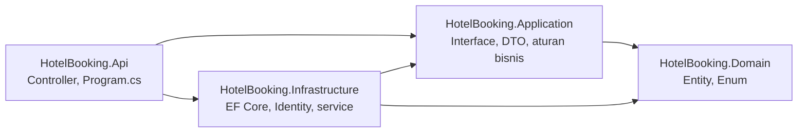
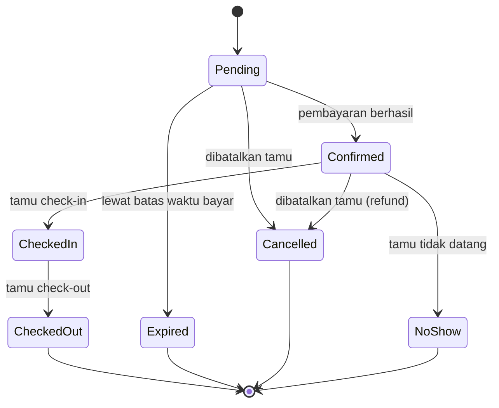

# Hotel Booking API

[](https://github.com/USERNAME/HotelBooking-Backend/actions/workflows/ci.yml)

Backend aplikasi pemesanan hotel berbasis **ASP.NET Core Web API (.NET 10)** dengan arsitektur berlapis, **Entity Framework Core**, dan **SQL Server**. Project portofolio untuk mendemonstrasikan desain backend .NET: pemodelan data, alur status booking, pencegahan double booking, dan aturan bisnis ketersediaan kamar.

Frontend (Next.js, Tailwind CSS) dibuat terpisah di repository lain dan memanggil API ini.

> **Status:** backend lengkap. Dari pencarian kamar sampai laporan okupansi sudah berjalan, diuji dengan 61 tes otomatis (unit dan integrasi), dan bisa dijalankan dengan satu perintah Docker Compose.

## Coba dengan cepat

Cukup Docker, tanpa perlu memasang .NET atau SQL Server:

```bash
git clone https://github.com/USERNAME/HotelBooking-Backend.git
cd HotelBooking-Backend
cp .env.example .env        # lalu isi nilainya, lihat bagian "Menjalankan Project"
docker compose up --build
curl http://localhost:8080/health
```

API tersedia di `http://localhost:8080`. Impor koleksi Postman di [`docs/postman`](docs/postman) untuk mencoba semua endpoint berurutan.

---

## Daftar Isi

- [Fitur](#fitur)
- [Teknologi](#teknologi)
- [Arsitektur](#arsitektur)
- [Struktur Folder](#struktur-folder)
- [Alur dan Aturan Bisnis](#alur-dan-aturan-bisnis)
- [Menjalankan Project](#menjalankan-project)
- [Pengujian](#pengujian)
- [Endpoint API](#endpoint-api)
- [Reset dan Bersih-bersih](#reset-dan-bersih-bersih)
- [Masalah Umum](#masalah-umum)
- [Catatan Keamanan](#catatan-keamanan)
- [Roadmap](#roadmap)
- [Penulis](#penulis)

---

## Fitur

- [x] Solution berlapis (Domain, Application, Infrastructure, Api) dan project test
- [x] Model data: tipe kamar, kamar, booking, pembayaran, dan pengguna (ASP.NET Core Identity)
- [x] Migration EF Core dan data awal (3 tipe kamar, 5 kamar)
- [x] Autentikasi JWT dan tiga role (Guest, Receptionist, Admin), dengan seeding akun admin
- [x] Pengelolaan tipe kamar (admin) dan kamar (admin dan resepsionis), dengan slug ramah SEO
- [x] Pencarian ketersediaan kamar berdasarkan tanggal dan jumlah tamu
- [x] Booking tanpa double booking, bahkan saat banyak permintaan masuk bersamaan
- [x] Pembayaran simulasi, hold 15 menit, dan expired otomatis lewat background service
- [x] Pembatalan dengan refund otomatis untuk booking yang sudah dibayar
- [x] Check-in, check-out, dan penandaan no-show oleh resepsionis
- [x] Laporan okupansi dan pendapatan per hari (admin)
- [x] Dokumentasi API interaktif (OpenAPI dan Scalar), CORS untuk frontend Next.js, dan health check
- [x] 40 unit test dan 21 tes integrasi (SQL Server asli lewat Testcontainers)
- [x] Docker Compose dan CI dengan GitHub Actions
- [x] Koleksi Postman dengan pengecekan otomatis

---

## Teknologi

| Bagian | Teknologi |
|---|---|
| Bahasa dan framework | C#, ASP.NET Core Web API (.NET 10) |
| ORM | Entity Framework Core (code-first, migrations) |
| Database | Microsoft SQL Server 2022 |
| Identitas dan keamanan | ASP.NET Core Identity, JWT Bearer |
| Dokumentasi API | OpenAPI dan Scalar |
| Pengujian | xUnit, `WebApplicationFactory`, Testcontainers |
| Infrastruktur | Docker, Docker Compose, GitHub Actions |
| Uji manual | Postman |

---

## Arsitektur

Solution dipisah menjadi empat layer. Logika bisnis tidak bergantung pada database maupun HTTP, sehingga mudah diuji dan dikembangkan.



| Layer | Tanggung jawab |
|---|---|
| `Domain` | Entity dan enum. Tidak bergantung pada layer atau framework lain |
| `Application` | Kontrak (interface), DTO, dan aturan bisnis murni (fungsi tanpa efek samping, mudah diuji) |
| `Infrastructure` | `AppDbContext`, EF Core, migration, implementasi service, dan background service |
| `Api` | Controller, konfigurasi aplikasi, dan dokumentasi API |

---

## Struktur Folder

```
HotelBooking-Backend/
├── .github/workflows/ci.yml        # CI: build, unit test, tes integrasi, smoke test Docker
├── docs/postman/                   # Koleksi Postman
├── src/
│   ├── HotelBooking.Domain/        # Entity dan enum
│   ├── HotelBooking.Application/   # Interface, DTO, aturan bisnis
│   ├── HotelBooking.Infrastructure/# DbContext, migration, Identity, service
│   └── HotelBooking.Api/           # Controller dan Program.cs
├── tests/
│   └── HotelBooking.Tests/         # Unit test dan tes integrasi (xUnit)
├── Dockerfile
├── docker-compose.yml
├── .env.example                    # Contoh konfigurasi untuk Docker Compose
└── HotelBooking.slnx
```

---

## Alur dan Aturan Bisnis

### Status booking



### Ketersediaan kamar

Sebuah kamar tersedia untuk rentang `[checkIn, checkOut)` jika tidak ada booking aktif pada kamar itu yang tanggalnya bertabrakan. Booking aktif adalah `Confirmed`, `CheckedIn`, atau `Pending` yang belum lewat `ExpiresAt`. Dua rentang tanggal bertabrakan jika:

```
checkIn_baru < checkOut_lama  DAN  checkOut_baru > checkIn_lama
```

Tanggal check-out tidak dihitung sebagai malam menginap, sehingga tamu baru boleh check-in pada hari tamu lama check-out. Kamar berstatus `Maintenance` tidak ditawarkan. Aturan tanggal mengikuti jam hotel (WIB, UTC+7), dengan maksimal 30 malam per booking.

### Pencegahan double booking

- Saat booking dibuat, pengecekan ketersediaan diulang **di dalam transaksi** yang mengunci baris kamar (`UPDLOCK, ROWLOCK`). Permintaan paralel untuk kamar yang sama diproses bergantian.
- Kunci yang sama dipakai saat pembayaran dan saat check-in atau check-out, sehingga perubahan status tidak bisa saling menimpa.
- `Booking` memiliki `RowVersion` (concurrency token) untuk pembatalan, pembayaran, dan perubahan status oleh staf.
- Hal ini dibuktikan oleh tes integrasi: puluhan booking paralel untuk satu kamar hanya menghasilkan satu yang berhasil.

### Pembayaran dan kedaluwarsa

- Booking baru berstatus `Pending` dan menahan kamar selama 15 menit.
- Pembayaran adalah simulasi. Pembayaran yang gagal mengembalikan `200` dengan `payment.status = Failed`, dan booking tetap `Pending` sehingga tamu bisa mencoba lagi.
- `BookingExpiryService` (background service) mengubah booking `Pending` yang lewat batas waktu menjadi `Expired`, sehingga kamarnya bebas kembali.
- Membatalkan booking `Confirmed` otomatis mengubah pembayarannya menjadi `Refunded`.
- Total harga disimpan pada booking saat dibuat, sehingga perubahan tarif tidak mengubah booking lama.

### Front desk

- Check-in membutuhkan booking `Confirmed`, hari ini berada dalam masa menginap, dan kamar berstatus `Available`. Kamar lalu menjadi `Occupied`.
- Check-out mengubah kamar menjadi `Cleaning`. Resepsionis mengembalikannya ke `Available` setelah dibersihkan.
- No-show hanya boleh dicatat setelah tanggal check-in, dan tidak ada refund.
- Laporan okupansi menghitung room-night terjual dan pendapatan per hari, dengan rentang maksimal 92 hari (batas awal dan akhir sama-sama termasuk).

---

## Menjalankan Project

Ada dua cara menjalankan. Pilih sesuai kebutuhan:

| | Cara A: Docker Compose | Cara B: dotnet run |
|---|---|---|
| Cocok untuk | Mencoba project, demo, perangkat baru | Mengembangkan dan men-debug kode |
| Yang dibutuhkan | Docker saja | .NET SDK, Docker (untuk database), `dotnet-ef` |
| Alamat API | `http://localhost:8080` | `http://localhost:5047` |
| Database | Container `db` milik compose (volume `sqldata`), port host 1434 | Container `hotel-sqlserver`, port host 1433 |
| Konfigurasi | File `.env` | `dotnet user-secrets` |
| Migrasi database | Otomatis saat API start | Manual: `dotnet ef database update` |

Keduanya memakai database yang **terpisah**, jadi password dan datanya tidak saling terkait. Keduanya bisa menyala bersamaan karena portnya berbeda.

### Prasyarat

| Alat | Untuk apa | Catatan |
|---|---|---|
| [Docker Desktop](https://www.docker.com/products/docker-desktop/) | Cara A dan database Cara B | Di Mac Apple Silicon, aktifkan **Use Rosetta for x86_64/amd64 emulation** di Settings, karena SQL Server berjalan sebagai amd64 |
| [.NET 10 SDK](https://dotnet.microsoft.com/download) | Cara B, tes, migrasi | Cek: `dotnet --version`. Tidak dibutuhkan untuk Cara A |
| Git | Mengambil kode | |
| `dotnet-ef` | Migrasi di Cara B | `dotnet tool install --global dotnet-ef` |
| [Postman Desktop](https://www.postman.com/downloads/) | Uji API | Versi web tidak bisa memanggil `localhost` |

### Pasang di perangkat baru

```bash
git clone https://github.com/USERNAME/HotelBooking-Backend.git
cd HotelBooking-Backend
```

Hal yang **tidak ikut** ke Git dan harus dibuat ulang di perangkat baru:

| Hal | Alasannya | Dibuat di |
|---|---|---|
| File `.env` | Berisi password | Cara A, langkah 1 |
| User-secrets | Tersimpan di komputer, di luar repo | Cara B, langkah 2 |
| Data database | Tersimpan di volume Docker, bukan di Git | Terbuat otomatis, mulai dari kosong. Akun admin dibuat oleh seeder |

### Cara A: Docker Compose

**1. Buat file `.env`** (sekali saja per perangkat). Perintah ini sekaligus membuat kunci JWT acak:

```bash
cat > .env <<EOF
SA_PASSWORD=<password-sql-server>
JWT_KEY=$(openssl rand -base64 36)
ADMIN_EMAIL=admin@hotel.local
ADMIN_PASSWORD=<password-admin>
FRONTEND_ORIGIN=http://localhost:3000
EOF
```

| Variable | Aturan |
|---|---|
| `SA_PASSWORD` | Minimal 8 karakter, ada huruf besar, huruf kecil, dan angka. **Jangan memakai `;` atau `$`** |
| `JWT_KEY` | Minimal 32 karakter. Hasil `openssl rand -base64 36` sudah memenuhi |
| `ADMIN_EMAIL` | Email akun admin awal |
| `ADMIN_PASSWORD` | Minimal 8 karakter, ada huruf besar, huruf kecil, dan angka |
| `FRONTEND_ORIGIN` | Alamat frontend yang boleh memanggil API (CORS) |

Pastikan `.env` tidak masuk Git: `git check-ignore .env` harus mencetak `.env`.

**2. Nyalakan:**

```bash
docker compose up --build        # terminal terkunci, log terlihat
docker compose up -d             # di latar belakang
```

Build pertama memakan beberapa menit. Di Apple Silicon, SQL Server butuh sekitar satu menit untuk siap. Tanda berhasil di log: `db ... Healthy`, `Applying migration '...InitialCreate'`, dan `Now listening on: http://[::]:8080`.

**3. Cek:**

```bash
curl -i http://localhost:8080/health      # harus 200 Healthy
curl -s -X POST http://localhost:8080/api/auth/login \
  -H "Content-Type: application/json" \
  -d '{"email":"admin@hotel.local","password":"<password-admin>"}'
```

Dokumentasi Scalar tidak aktif di mode Production (sengaja). Pakai Postman, atau jalankan Cara B untuk melihat Scalar.

**4. Matikan:**

```bash
docker compose stop        # matikan, data tetap ada
docker compose down        # hapus container, data tetap ada (di volume)
docker compose down -v     # hapus container DAN data database
```

### Cara B: dotnet run untuk pengembangan

**1. Database SQL Server** (sekali saja per perangkat). Ganti `<password-sql-server>` dengan password pilihanmu (minimal 8 karakter, ada huruf besar, kecil, angka, dan simbol). Hapus `--platform linux/amd64` kalau komputermu bukan Apple Silicon.

```bash
docker run --platform linux/amd64 \
  -e "ACCEPT_EULA=Y" -e "MSSQL_SA_PASSWORD=<password-sql-server>" \
  -p 1433:1433 --name hotel-sqlserver \
  -d mcr.microsoft.com/mssql/server:2022-latest
```

**2. User-secrets** (sekali saja per perangkat). Konfigurasi sensitif tidak disimpan di repository:

```bash
dotnet user-secrets init --project src/HotelBooking.Api

dotnet user-secrets set "ConnectionStrings:DefaultConnection" "Server=localhost,1433;Database=HotelBookingDb;User Id=sa;Password=<password-sql-server>;TrustServerCertificate=True" --project src/HotelBooking.Api
dotnet user-secrets set "Jwt:Key" "$(openssl rand -base64 48)" --project src/HotelBooking.Api
dotnet user-secrets set "SeedAdmin:Email" "admin@hotel.local" --project src/HotelBooking.Api
dotnet user-secrets set "SeedAdmin:Password" "<password-admin>" --project src/HotelBooking.Api
```

Gunakan tanda kutip lurus (`"`), bukan kutip melengkung. Cek isinya dengan `dotnet user-secrets list --project src/HotelBooking.Api` (harus ada empat baris). Alamat frontend untuk CORS sudah ada di `appsettings.Development.json`.

**3. Buat database dan tabel** (sekali saja, dan setiap ada migration baru):

```bash
dotnet ef database update \
  --project src/HotelBooking.Infrastructure \
  --startup-project src/HotelBooking.Api
```

**4. Jalankan:**

```bash
dotnet run --project src/HotelBooking.Api
```

| Alamat | Isi |
|---|---|
| `http://localhost:5047/health` | Health check |
| `http://localhost:5047/scalar` | Dokumentasi API interaktif (kalau tidak terbuka, coba `/scalar/v1`) |

Hentikan dengan **Ctrl+C**. Seeder hanya membuat akun admin kalau belum ada, jadi mengubah `SeedAdmin:Password` setelah admin terbuat tidak mengubah password admin yang sudah ada di database.

### Nyalakan dan matikan sehari-hari

Setelah komputer dimatikan, container tidak otomatis menyala lagi. **Data tidak hilang**, karena tersimpan di volume Docker. Mulai dengan membuka Docker Desktop dan tunggu sampai statusnya "Running".

| | Cara A (Docker Compose) | Cara B (dotnet run) |
|---|---|---|
| Nyalakan | `docker compose up -d`, tunggu sekitar 1 menit, cek `/health` | `docker start hotel-sqlserver`, tunggu beberapa detik, lalu `dotnet run --project src/HotelBooking.Api` |
| Matikan | `docker compose stop` | Ctrl+C untuk API, lalu `docker stop hotel-sqlserver` |

| Tujuan | Perintah |
|---|---|
| Lihat container yang menyala | `docker ps` |
| Lihat semua container (termasuk mati) | `docker ps -a` |
| Log API compose | `docker compose logs -f api` |
| Log database compose | `docker compose logs -f db` |
| Bangun ulang setelah kode berubah | `docker compose up --build` |

---

## Pengujian

### Unit test dan tes integrasi

```bash
dotnet test                                          # semua (61 tes)
dotnet test --filter "Category!=Integration"         # hanya unit test (cepat)
dotnet test --filter "Category=Integration"          # hanya tes integrasi
```

Tes integrasi menjalankan API sungguhan terhadap SQL Server sementara lewat Testcontainers, jadi **Docker Desktop harus menyala**. Pastikan variabel `TEST_DB_CONNECTION` tidak sedang di-export di terminalmu (`unset TEST_DB_CONNECTION`), kecuali kamu memang sengaja memakai SQL Server sendiri. Isi tesnya antara lain: kontrol akses per role, ketersediaan kamar, alur lengkap booking sampai check-out, booking dan pembayaran paralel, serta kedaluwarsa booking.

### Postman

1. Impor `docs/postman/HotelBooking.postman_collection.json`.
2. Di tab **Variables** koleksi, isi **Current value**:
   - `baseUrl`: `http://localhost:8080` (Cara A) atau `http://localhost:5047` (Cara B)
   - `adminPassword`: password admin yang sesuai dengan cara yang dipakai
3. Klik kanan koleksi, **Run collection**, jalankan dengan urutan bawaan. Semua tes seharusnya hijau. Kedaluwarsa booking tidak bisa diuji dari Postman, dan sudah dicakup tes integrasi.

---

## Endpoint API

| Method | Endpoint | Deskripsi | Akses |
|---|---|---|---|
| GET | `/health` | Health check (termasuk koneksi database) | Publik |
| POST | `/api/auth/register` | Daftar akun tamu | Publik |
| POST | `/api/auth/login` | Login dan dapatkan token | Publik |
| GET | `/api/auth/me` | Profil pengguna saat ini | Login |
| POST | `/api/admin/staff` | Buat akun resepsionis | Admin |
| GET | `/api/room-types` | Daftar tipe kamar, diurutkan dari harga terendah | Publik |
| GET | `/api/room-types/{slug}` | Detail satu tipe kamar berdasarkan slug | Publik |
| POST | `/api/room-types` | Buat tipe kamar | Admin |
| PUT | `/api/room-types/{id}` | Ubah tipe kamar | Admin |
| DELETE | `/api/room-types/{id}` | Hapus tipe kamar (ditolak jika masih punya kamar) | Admin |
| GET | `/api/admin/rooms` | Daftar kamar, bisa difilter | Admin, Resepsionis |
| GET | `/api/admin/rooms/{id}` | Detail kamar | Admin, Resepsionis |
| POST | `/api/admin/rooms` | Tambah kamar | Admin |
| PUT | `/api/admin/rooms/{id}` | Ubah kamar | Admin |
| DELETE | `/api/admin/rooms/{id}` | Hapus kamar (ditolak jika punya riwayat booking) | Admin |
| PATCH | `/api/admin/rooms/{id}/status` | Ubah status kamar (Available, Cleaning, Maintenance) | Admin, Resepsionis |
| GET | `/api/rooms/available` | Cari tipe kamar tersedia (`checkIn`, `checkOut`, `guests`) | Publik |
| POST | `/api/bookings` | Buat booking (status `Pending`, ditahan 15 menit) | Tamu |
| GET | `/api/bookings/my` | Riwayat booking sendiri | Tamu |
| GET | `/api/bookings/{id}` | Detail booking sendiri | Tamu |
| POST | `/api/bookings/{id}/pay` | Bayar booking (simulasi, bisa dipaksa gagal) | Tamu |
| GET | `/api/bookings/{id}/payments` | Riwayat pembayaran booking | Tamu |
| POST | `/api/bookings/{id}/cancel` | Batalkan booking (refund jika sudah dibayar) | Tamu |
| GET | `/api/admin/bookings` | Daftar booking, filter `status`, `checkIn`, `checkOut`, `code` | Admin, Resepsionis |
| GET | `/api/admin/bookings/{id}` | Detail booking | Admin, Resepsionis |
| POST | `/api/admin/bookings/{id}/check-in` | Check-in tamu | Admin, Resepsionis |
| POST | `/api/admin/bookings/{id}/check-out` | Check-out tamu | Admin, Resepsionis |
| POST | `/api/admin/bookings/{id}/no-show` | Tandai tamu tidak datang | Admin, Resepsionis |
| GET | `/api/admin/reports/occupancy` | Laporan okupansi (`from`, `to`, maksimal 92 hari) | Admin |

Kode status yang dipakai: `200` berhasil, `201` data dibuat, `400` input tidak valid, `401` belum login, `403` role tidak sesuai, `404` tidak ditemukan, `409` bentrok dengan aturan bisnis atau data lain (misalnya kamar habis, status tidak mengizinkan).

Contoh respons `GET /api/room-types/deluxe`:

```json
{
  "id": 2,
  "name": "Deluxe",
  "slug": "deluxe",
  "description": "Kamar lebih luas dengan fasilitas tambahan.",
  "basePrice": 750000,
  "capacity": 3,
  "imageUrl": null
}
```

---

## Reset dan Bersih-bersih

| Tujuan | Perintah | Efek |
|---|---|---|
| Kosongkan database Cara A | `docker compose down -v` lalu `docker compose up` | Data hilang, admin dibuat ulang oleh seeder |
| Kosongkan database Cara B | `dotnet ef database drop --project src/HotelBooking.Infrastructure --startup-project src/HotelBooking.Api`, lalu `dotnet ef database update ...` | Data hilang, admin dibuat ulang saat API start |
| Hapus container Cara B | `docker rm -f hotel-sqlserver` | Database Cara B hilang, buat ulang lewat Cara B langkah 1 |
| Bersihkan cache Docker | `docker system prune` | Menghapus image dan cache yang tidak terpakai. Baca peringatannya dulu |
| Hapus secrets | `dotnet user-secrets clear --project src/HotelBooking.Api` | Semua secrets proyek ini hilang |

---

## Masalah Umum

| Gejala | Penyebab dan solusi |
|---|---|
| `Cannot connect to the Docker daemon` | Docker Desktop belum menyala. Buka aplikasinya dan tunggu sampai "Running" |
| `port is already allocated` | Port sudah dipakai proses lain. `docker ps` menunjukkan siapa. Port yang dipakai: 8080 (API compose), 1434 (database compose), 1433 (`hotel-sqlserver`), 5047 (`dotnet run`) |
| `Login failed for user 'sa'` di compose | `SA_PASSWORD` di `.env` diubah setelah volume dibuat. Jalankan `docker compose down -v` lalu `up` lagi |
| `Login failed for user 'sa'` di `dotnet run` | Password di connection string user-secrets berbeda dari password saat container `hotel-sqlserver` dibuat, atau containernya mati (`docker start hotel-sqlserver`) |
| `Login failed ... Failed to open the explicitly specified database` sekali di awal log compose | Normal. Itu percobaan koneksi sebelum database dibuat oleh migrasi |
| `Jwt:Key belum diatur` | Di Cara A, `JWT_KEY` di `.env` kosong atau kurang dari 32 karakter. Di Cara B, jalankan ulang `user-secrets set "Jwt:Key" ...` |
| `Gagal membuat admin awal` | Password admin kurang kuat. Butuh minimal 8 karakter, huruf besar, huruf kecil, dan angka |
| Admin tidak bisa login padahal password sudah diganti | Seeder tidak mengubah admin yang sudah ada. Kosongkan database (bagian Reset) |
| Database compose tidak kunjung `healthy` di Mac | Tunggu 1 sampai 2 menit. Cek `docker compose logs db`, dan pastikan Rosetta aktif di Docker Desktop |
| `A network-related or instance-specific error` di `dotnet run` | SQL Server belum siap atau mati. `docker start hotel-sqlserver`, tunggu beberapa detik |
| `dotnet ef` tidak ditemukan | `dotnet tool install --global dotnet-ef`, lalu buka terminal baru |
| Tes integrasi gagal dengan error Docker | Docker Desktop belum menyala |
| Postman: `Could not get response` | Pakai Postman Desktop dan cek port di `baseUrl` |
| Postman: 401 di tengah run | Token kedaluwarsa. Jalankan ulang dari folder `00 Setup` |

---

## Catatan Keamanan

- Jangan men-commit `.env`. Hanya `.env.example` (berisi nilai contoh) yang boleh masuk Git.
- Jangan menempelkan password, kunci JWT, atau isi `user-secrets list` ke chat, issue, atau screenshot publik.
- Password dan kunci di dokumen ini hanya untuk pengembangan lokal. Untuk server sungguhan, buat nilai baru yang acak dan simpan di pengelola secrets milik penyedia hosting, bukan di file.
- Kalau ada password yang terlanjur tersebar, ganti: untuk `hotel-sqlserver`, hapus dan buat ulang containernya, lalu perbarui user-secrets. Untuk compose, ubah `.env` lalu `docker compose down -v`.

---

## Roadmap

1. ~~Autentikasi JWT dan role~~
2. ~~CRUD tipe kamar dan kamar untuk admin~~
3. ~~Ketersediaan kamar dan pembuatan booking~~
4. ~~Pembayaran simulasi dan expired otomatis~~
5. ~~Check-in, check-out, dan laporan okupansi~~
6. ~~Unit test dan tes integrasi~~
7. ~~Docker Compose dan GitHub Actions~~
8. Frontend Next.js + Tailwind CSS (repository terpisah)

---

## Penulis

Dibuat oleh **Hasta**.

- GitHub: [@USERNAME](https://github.com/USERNAME)
